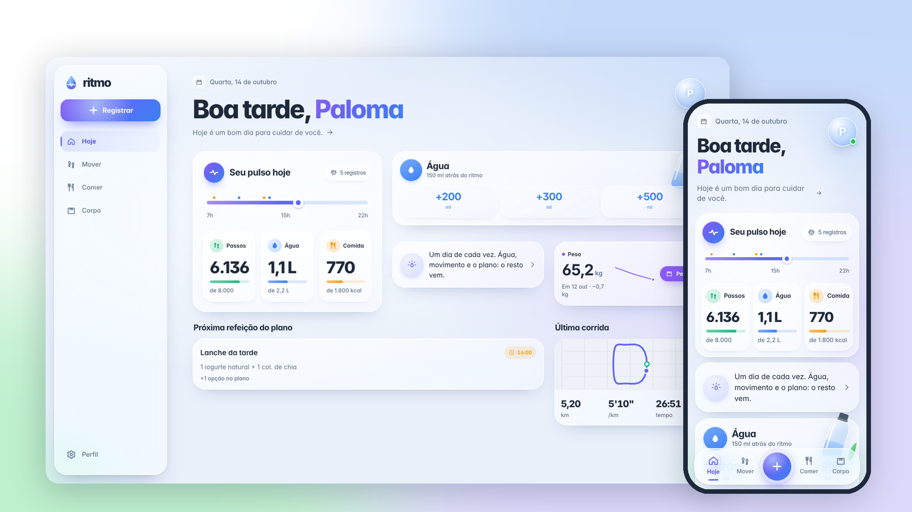
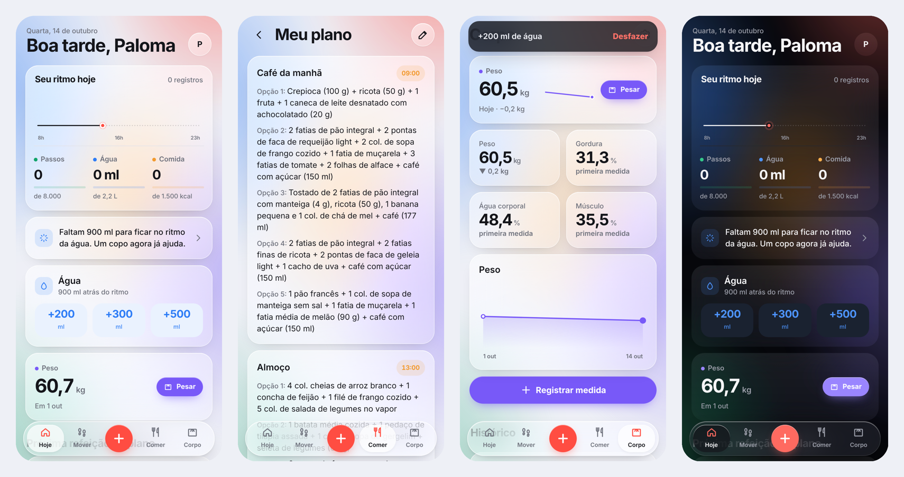

<div align="center">


# ritmo

### Saúde do dia a dia num app só: comida com IA, água, corpo e corridas.

**Beba água. Cuide do seu ritmo.**

[](https://ritmo-tau-inky.vercel.app/)


<br />



</div>

## O problema

Quem segue um plano alimentar e tenta se mexer mais acaba com cinco apps abertos: um para a água, outro para contar calorias, uma planilha para o peso e o PDF da nutricionista perdido no WhatsApp. Nenhum conversa com o outro, e anotar tudo vira trabalho.

## A solução

O **ritmo** junta tudo numa tela só e tira o trabalho do caminho:

- **Uma foto do prato** e a IA lista os alimentos, estima porções, calorias e macros, e diz se a refeição está dentro do seu plano.
- **O plano da nutricionista vira o app.** Mande o PDF ou fotos: a IA organiza as refeições por horário, com as opções de substituição, e as metas do plano passam a ser as metas do dia.
- **As corridas vêm do Strava**: corra com a tela bloqueada ou com o relógio, e o trajeto, o pace e as parciais aparecem no ritmo.
- **Água em um toque**, com o ritmo do dia: o app sabe se você está atrasada para a meta, e quanto.
- **Corpo com contexto**: peso, gordura, músculo e água corporal com gráfico, e uma balança para anotar o peso em segundos.
- **Lembretes que entendem o seu dia**: notificação de água só quando você está atrás do ritmo, da refeição do plano no horário (se ainda não registrou) e o resumo no domingo à noite.
- **Resumo da semana**: peso, dias dentro das calorias, proteína, água e o que dá para ajustar, com dicas da IA baseadas no seu plano.

Tudo isso com a cara de um app nativo: instala na tela inicial do iPhone, abre em tela cheia e funciona offline.

<div align="center">



</div>

## Funcionalidades

### Hoje
O painel do dia. A **linha do tempo** mostra do acordar ao dormir, com um ponto colorido para cada registro e um marcador no agora. Logo abaixo, proteína, água e comida com barras de progresso, um **lembrete inteligente** ("Faltam **900 ml** para ficar no ritmo da água") e a próxima refeição do plano.

### Comer
- **Foto do prato** com análise por IA e revisão das porções antes de salvar.
- **Descrever em texto** ("2 ovos e 1 pão francês") quando não dá para fotografar.
- **Perguntar**: dúvidas rápidas respondidas com base no seu plano ("posso trocar arroz por batata?").
- **Pratos frequentes** com um toque, e fotos sem internet que esperam na fila para analisar depois.

### Mover
- **Corridas do Strava**: conecte uma vez e as corridas e caminhadas entram sozinhas, com mapa, pace e parciais por km.
- **Corrida com GPS** direto no app, quando preferir: mapa da rota, pace atual e médio, parciais, recordes e importação de GPX.

### Corpo
- **Balança**: anote o peso com um toque e veja a variação.
- **Bioimpedância**: tire foto do laudo e a IA preenche peso, gordura, músculo e água.
- **Pontos de atenção** a partir das suas metas, que a IA leva em conta nas dicas de comida.

### Água
Copos personalizados, desfazer, histórico de 7 e 30 dias e sequência de dias na meta.

### Lembretes
Notificações de verdade no iPhone (com o ritmo instalado na Tela de Início) e no computador, mesmo com o app fechado:
- **Água**: só quando você está atrás do ritmo do dia, no máximo a cada 2 horas, e nunca logo depois de um copo.
- **Refeições do plano**: no horário de cada uma, com a opção do plano, se ainda não foi registrada.
- **Resumo da semana**: domingo à noite.

Nada antes de acordar nem depois de dormir, e cada tipo liga e desliga no Perfil.

### Resumo da semana
Segunda a domingo numa tela: peso e variação, quantos dias ficaram dentro das calorias (e quais passaram), proteína média, água e corridas. Logo abaixo, o que foi bem, o que dá para ajustar e, se quiser, dicas da IA para a próxima semana.

## Design

Vidro fosco sobre luz azul difusa, tipografia Inter, azul e azul-violeta como marca e uma cor por área (verde para proteína, azul para água, laranja para comida, violeta para o corpo).

- **Celular:** barra de navegação flutuante, botão central para registrar qualquer coisa.
- **Notebook e PC:** navegação lateral e o Hoje vira um painel em colunas.
- **Claro e escuro**, seguindo o sistema ou escolhido no Perfil.
- Ícone e telas de abertura próprios para o iPhone.

## Privacidade

- Cada pessoa só enxerga os próprios dados: as regras do banco bloqueiam qualquer acesso que não seja o da dona da conta, só aceitam as coleções do app e põem teto no tamanho dos documentos.
- Contas novas começam vazias; nada de uma conta passa para outra.
- A IA é protegida por **App Check**: só o app publicado consegue usá-la.
- **Sair** apaga do aparelho o cache offline, a fila de fotos e as notificações daquele aparelho. Dá para **sair de todos os aparelhos** e **apagar a conta e todos os dados** no Perfil.
- Cabeçalhos de segurança na Vercel (nosniff, frame, referrer, permissões de câmera e localização).
- Uma página de **Privacidade** explica o que fica guardado e o que vai para a IA (o plano gratuito do Gemini pode usar o conteúdo para melhorar os produtos do Google).

## Como é feito

| Camada | Escolha |
| --- | --- |
| Interface | React 18 · Vite · TypeScript · CSS próprio, sem framework visual |
| App instalável | PWA com cache offline e telas de abertura do iOS |
| Login | Firebase Authentication (Google) |
| Banco | Cloud Firestore com cache offline |
| IA | Firebase AI Logic + Gemini, respostas em JSON por schema, troca de modelo automática se um estiver lotado |
| Proteção | App Check com Fraud Defense (reCAPTCHA Enterprise) |
| Corridas | Strava API (OAuth) → função serverless `/api/strava` |
| Lembretes | Web Push (VAPID) pela função `/api/lembretes`, com Firebase Admin; GitHub Actions chama a cada 30 min |
| Mapa | Leaflet + OpenStreetMap, com desenho em SVG quando não há internet |
| Hospedagem | Vercel |

As contas (distância por Haversine, filtro de GPS, parciais, ritmo da água, sequências, porções, pontos de atenção, o lembrete do dia, o resumo da semana e quando mandar cada notificação) são funções puras em `src/lib`, cada uma com teste.

```
api/            corridas do Strava, lembretes e segurança da conta (com teste)
src/
  app/          estado global, rotas e ações compartilhadas
  componentes/  linha do dia, balança, gráficos, mapa, navegação, ícones
  dados/        Firestore e o modo demonstração (mesma interface)
  ia/           prompts e chamadas ao Gemini
  lib/          as contas, cada uma com teste
  telas/        uma tela por arquivo
```

## Rodar no computador

```bash
npm install
npm run demo   # dados de exemplo, sem configurar nada
npm run dev    # com o Firebase de verdade (precisa do .env)
```

| Comando | Para quê |
| --- | --- |
| `npm run demo` | Ver todas as telas com uma semana de dados de exemplo |
| `npm run dev` | Rodar com Firebase, login e IA |
| `npm run build` | Gerar a versão de produção |
| `npm test` | Rodar os testes |
| `npm run typecheck` | Checar os tipos |
| `npm run icones` | Regerar ícones e telas de abertura a partir de `public/logo.svg` |

## Publicar

### Firebase
1. Crie o projeto, ative **Authentication → Google** e crie o **Firestore** (edição Standard, `southamerica-east1`).
2. Cole o conteúdo de `firestore.rules` na aba **Regras** do Firestore e publique (de novo a cada versão que mudar esse arquivo).
3. **AI Logic → Começar → Gemini Developer API** (funciona no plano grátis).
4. **App Check → Apps →** registre o app web com **Fraud Defense** usando a chave de site do reCAPTCHA (criada em Google Cloud → Segurança → reCAPTCHA, tipo Web, sem desafio de caixa).
5. **Authentication → Configurações → Domínios autorizados:** adicione o domínio da Vercel.

### Google Cloud
Em **APIs e serviços → Credenciais → Web client (auto created by Google Service)**, adicione o domínio em *Origens JavaScript autorizadas* e `https://SEU-DOMINIO/__/auth/handler` em *URIs de redirecionamento autorizados*.

### Vercel
Importe o repositório (framework **Vite**) e cadastre as variáveis do `.env.example`:

| Variável | Valor |
| --- | --- |
| `VITE_FIREBASE_*` | A config do app web do Firebase |
| `VITE_FIREBASE_AUTH_DOMAIN` | O domínio da **Vercel** (não o `firebaseapp.com`): é o que faz o login funcionar no app instalado no iPhone |
| `VITE_RECAPTCHA_ENTERPRISE_KEY` | A chave de site usada no App Check |
| `VITE_GEMINI_MODEL` | Opcional. Padrão `gemini-3.5-flash-lite`, com `gemini-3.5-flash` de reserva |
| `STRAVA_CLIENT_ID` e `STRAVA_CLIENT_SECRET` | Do app criado em strava.com/settings/api (só no servidor) |
| `FIREBASE_SERVICE_ACCOUNT` | O JSON da conta de serviço do Firebase, para os lembretes (só no servidor) |
| `CRON_SECRET` | Opcional. Se definir, use o mesmo valor no segredo do GitHub Actions |

O `vercel.json` encaminha `/__/auth` para o `firebaseapp.com` do projeto. Se trocar de projeto Firebase, troque ali também.

### Strava
Em **strava.com/settings/api**, crie um app com o domínio da Vercel em *Authorization Callback Domain*. Cadastre o Client ID e o Client Secret na Vercel e, no ritmo, toque em **Perfil → Strava → Conectar**.

### Lembretes
1. No Firebase, **Configurações do projeto → Contas de serviço → Gerar nova chave privada**. Abra o arquivo baixado e cole o conteúdo inteiro em `FIREBASE_SERVICE_ACCOUNT` na Vercel. As chaves das notificações saem dele, sem mais nada para gerar.
2. O agendador já vem no repositório (`.github/workflows/lembretes.yml`): o GitHub Actions chama `/api/lembretes` a cada 30 minutos, das 6h às 23h30. Confira em **Actions** que o workflow "Lembretes" está ativo (dá para rodar na mão em *Run workflow*).
3. No iPhone, abra o ritmo instalado na Tela de Início, vá em **Perfil → Lembretes → Ativar notificações** e toque em **Enviar teste**.

## Próximos passos

- Compartilhar o progresso com a nutricionista (o resumo da semana em PDF para a consulta).
- Lembrete de pesagem semanal.
- Planos para mais de uma pessoa (hoje o app é pessoal).

---

<div align="center">

**ritmo** · pequenos hábitos, grandes resultados.

© 2026 Paloma Lorenzon. Todos os direitos reservados.

</div>
